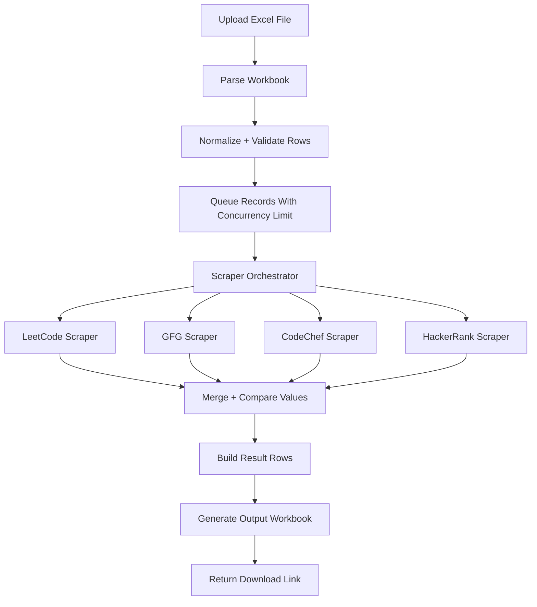

# Bulk Coding Profile Verification Utility (Standalone)

This document is a full, self-contained implementation guide and source package for a standalone application that:

1. Accepts an Excel file with ~600-700 student records.
2. Validates input row-by-row.
3. Scrapes latest data from LeetCode, GeeksforGeeks, CodeChef, and HackerRank profile URLs.
4. Compares student-entered values with scraped values.
5. Generates a verified output Excel file.

This is intentionally outside the existing Code Tracker app and should be built as a separate service.

---

## 1) System Architecture



Design goals:

- Stable for 600-700 records in one run.
- Retry and timeout protection for scraping.
- Fault-tolerant per row (one failed profile should not break full batch).
- Deterministic output schema.
- Reusable scraper contracts.

---

## 2) Recommended Tech Stack

- Runtime: Node.js 20+
- API: Express
- Upload handling: Multer
- Excel read/write: xlsx
- HTTP scraping utilities: axios + cheerio
- Controlled concurrency: p-limit
- Retry helper: async-retry
- Validation: zod
- Logging: pino
- Optional browser-based fallback: playwright

---

## 3) Folder Structure

```text
bulk-profile-verifier/
  package.json
  .env.example
  README.md
  src/
    app.js
    server.js
    config/
      env.js
      logger.js
    constants/
      columns.js
      defaults.js
    routes/
      verifyRoutes.js
    middleware/
      errorHandler.js
      upload.js
    services/
      verifierService.js
      rowProcessor.js
      comparisonService.js
      workbookService.js
    scrapers/
      index.js
      leetcode.js
      gfg.js
      codechef.js
      hackerrank.js
      utils.js
    validators/
      inputSchema.js
    utils/
      normalizers.js
      retry.js
      urlHelpers.js
  uploads/
  outputs/
```

---

## 4) Input and Output Excel Format

### Input Columns (required)

- Roll Number
- Student Name
- LeetCode Profile URL
- GeeksforGeeks Profile URL
- CodeChef Profile URL
- HackerRank Profile URL
- Student-entered platform statistics

### Output Columns

Keep all input columns and append:

- Validation Status
- Validation Message
- LC Total (Scraped)
- GFG Total (Scraped)
- CodeChef Problems (Scraped)
- HackerRank Stars (Scraped)
- LC Match
- GFG Match
- CodeChef Match
- HackerRank Match
- Overall Match
- Scrape Errors

Matching rule example:

- LC Match = YES when student-entered LC total equals scraped LC total, else NO.

---

## 5) Installation and Run Commands

```bash
mkdir bulk-profile-verifier
cd bulk-profile-verifier
npm init -y
npm install express multer xlsx axios cheerio p-limit async-retry zod pino pino-pretty
npm install -D nodemon
```

Optional fallback scraping (if static parsing fails often):

```bash
npm install playwright
npx playwright install
```

Add scripts in package.json:

```json
{
  "name": "bulk-profile-verifier",
  "version": "1.0.0",
  "main": "src/server.js",
  "type": "commonjs",
  "scripts": {
    "dev": "nodemon src/server.js",
    "start": "node src/server.js"
  }
}
```

Run:

```bash
npm run dev
```

Service starts on default port 6060.

---

## 6) Environment File

Create .env:

```env
PORT=6060
MAX_CONCURRENCY=8
REQUEST_TIMEOUT_MS=15000
MAX_RETRIES=2
UPLOAD_DIR=uploads
OUTPUT_DIR=outputs
```

---

## 7) Complete Source Code

### src/config/env.js

```js
require("dotenv").config();

function toInt(value, fallback) {
  const parsed = Number.parseInt(value, 10);
  return Number.isNaN(parsed) ? fallback : parsed;
}

module.exports = {
  PORT: toInt(process.env.PORT, 6060),
  MAX_CONCURRENCY: toInt(process.env.MAX_CONCURRENCY, 8),
  REQUEST_TIMEOUT_MS: toInt(process.env.REQUEST_TIMEOUT_MS, 15000),
  MAX_RETRIES: toInt(process.env.MAX_RETRIES, 2),
  UPLOAD_DIR: process.env.UPLOAD_DIR || "uploads",
  OUTPUT_DIR: process.env.OUTPUT_DIR || "outputs",
};
```

### src/config/logger.js

```js
const pino = require("pino");

const logger = pino({
  transport:
    process.env.NODE_ENV !== "production"
      ? { target: "pino-pretty", options: { colorize: true } }
      : undefined,
});

module.exports = logger;
```

### src/constants/columns.js

```js
module.exports = {
  INPUT_COLUMNS: {
    ROLL_NO: "Roll Number",
    NAME: "Student Name",
    LC_URL: "LeetCode Profile URL",
    GFG_URL: "GeeksforGeeks Profile URL",
    CC_URL: "CodeChef Profile URL",
    HR_URL: "HackerRank Profile URL",
    LC_STUDENT: "LC Total (Student)",
    GFG_STUDENT: "GFG Total (Student)",
    CC_STUDENT: "CodeChef Problems (Student)",
    HR_STUDENT: "HackerRank Stars (Student)",
  },
  OUTPUT_COLUMNS: {
    VALIDATION_STATUS: "Validation Status",
    VALIDATION_MESSAGE: "Validation Message",
    LC_SCRAPED: "LC Total (Scraped)",
    GFG_SCRAPED: "GFG Total (Scraped)",
    CC_SCRAPED: "CodeChef Problems (Scraped)",
    HR_SCRAPED: "HackerRank Stars (Scraped)",
    LC_MATCH: "LC Match",
    GFG_MATCH: "GFG Match",
    CC_MATCH: "CodeChef Match",
    HR_MATCH: "HackerRank Match",
    OVERALL_MATCH: "Overall Match",
    SCRAPE_ERRORS: "Scrape Errors",
  },
};
```

### src/constants/defaults.js

```js
module.exports = {
  MATCH_YES: "YES",
  MATCH_NO: "NO",
  STATUS_VALID: "VALID",
  STATUS_INVALID: "INVALID",
};
```

### src/utils/urlHelpers.js

```js
function safeUrl(value) {
  if (!value || typeof value !== "string") return "";
  return value.trim();
}

function isHttpUrl(value) {
  try {
    const u = new URL(value);
    return u.protocol === "http:" || u.protocol === "https:";
  } catch {
    return false;
  }
}

module.exports = {
  safeUrl,
  isHttpUrl,
};
```

### src/utils/normalizers.js

```js
function toInt(value, fallback = 0) {
  const parsed = Number.parseInt(String(value ?? "").trim(), 10);
  return Number.isNaN(parsed) ? fallback : parsed;
}

function text(value) {
  return String(value ?? "").trim();
}

module.exports = {
  toInt,
  text,
};
```

### src/utils/retry.js

```js
const retry = require("async-retry");
const { MAX_RETRIES } = require("../config/env");

async function withRetry(fn) {
  return retry(
    async (bail, attempt) => {
      try {
        return await fn(attempt);
      } catch (err) {
        // Bail on known non-retryable input failures
        if (err && err.nonRetryable) {
          bail(err);
          return null;
        }
        throw err;
      }
    },
    {
      retries: MAX_RETRIES,
      minTimeout: 600,
      maxTimeout: 3000,
      factor: 2,
    }
  );
}

module.exports = {
  withRetry,
};
```

### src/validators/inputSchema.js

```js
const { z } = require("zod");
const { isHttpUrl, safeUrl } = require("../utils/urlHelpers");
const { INPUT_COLUMNS } = require("../constants/columns");

const studentRowSchema = z.object({
  [INPUT_COLUMNS.ROLL_NO]: z.string().min(1),
  [INPUT_COLUMNS.NAME]: z.string().min(1),
  [INPUT_COLUMNS.LC_URL]: z.string().optional(),
  [INPUT_COLUMNS.GFG_URL]: z.string().optional(),
  [INPUT_COLUMNS.CC_URL]: z.string().optional(),
  [INPUT_COLUMNS.HR_URL]: z.string().optional(),
  [INPUT_COLUMNS.LC_STUDENT]: z.any(),
  [INPUT_COLUMNS.GFG_STUDENT]: z.any(),
  [INPUT_COLUMNS.CC_STUDENT]: z.any(),
  [INPUT_COLUMNS.HR_STUDENT]: z.any(),
});

function validateRow(row) {
  const parsed = studentRowSchema.safeParse(row);
  if (!parsed.success) {
    return {
      ok: false,
      message: parsed.error.issues.map((i) => i.message).join("; "),
    };
  }

  const urlFields = [
    INPUT_COLUMNS.LC_URL,
    INPUT_COLUMNS.GFG_URL,
    INPUT_COLUMNS.CC_URL,
    INPUT_COLUMNS.HR_URL,
  ];

  for (const key of urlFields) {
    const value = safeUrl(row[key]);
    if (value && !isHttpUrl(value)) {
      return { ok: false, message: `${key} must be a valid HTTP/HTTPS URL` };
    }
  }

  return { ok: true, message: "" };
}

module.exports = {
  validateRow,
};
```

### src/scrapers/utils.js

```js
const axios = require("axios");
const cheerio = require("cheerio");
const { REQUEST_TIMEOUT_MS } = require("../config/env");

async function fetchHtml(url) {
  const response = await axios.get(url, {
    timeout: REQUEST_TIMEOUT_MS,
    headers: {
      "User-Agent":
        "Mozilla/5.0 (X11; Linux x86_64) AppleWebKit/537.36 (KHTML, like Gecko) Chrome/126.0.0.0 Safari/537.36",
      Accept: "text/html,application/xhtml+xml",
    },
  });
  return response.data;
}

function load(html) {
  return cheerio.load(html);
}

module.exports = {
  fetchHtml,
  load,
};
```

### src/scrapers/leetcode.js

```js
const { fetchHtml, load } = require("./utils");

async function scrapeLeetCode(profileUrl) {
  if (!profileUrl) return { totalSolved: null, error: "Missing URL" };

  try {
    // If LeetCode blocks HTML parsing, replace with GraphQL username-based query.
    const html = await fetchHtml(profileUrl);
    const $ = load(html);

    // Fallback parsing: adjust selector based on real page snapshot.
    const solvedText = $("[data-testid='user-solved-count']").first().text();
    const totalSolved = Number.parseInt((solvedText || "0").replace(/\D/g, ""), 10) || 0;

    return { totalSolved, error: "" };
  } catch (err) {
    return { totalSolved: null, error: err.message };
  }
}

module.exports = scrapeLeetCode;
```

### src/scrapers/gfg.js

```js
const { fetchHtml, load } = require("./utils");

async function scrapeGfg(profileUrl) {
  if (!profileUrl) return { totalSolved: null, error: "Missing URL" };

  try {
    const html = await fetchHtml(profileUrl);
    const $ = load(html);

    // Selector must be aligned with latest GFG profile DOM.
    const solvedText = $(".score_card_value").first().text();
    const totalSolved = Number.parseInt((solvedText || "0").replace(/\D/g, ""), 10) || 0;

    return { totalSolved, error: "" };
  } catch (err) {
    return { totalSolved: null, error: err.message };
  }
}

module.exports = scrapeGfg;
```

### src/scrapers/codechef.js

```js
const { fetchHtml, load } = require("./utils");

async function scrapeCodeChef(profileUrl) {
  if (!profileUrl) return { problemsSolved: null, error: "Missing URL" };

  try {
    const html = await fetchHtml(profileUrl);
    const $ = load(html);

    // Selector may need update based on current CodeChef profile layout.
    const solvedText = $(".rating-data-section .content h3").first().text();
    const problemsSolved = Number.parseInt((solvedText || "0").replace(/\D/g, ""), 10) || 0;

    return { problemsSolved, error: "" };
  } catch (err) {
    return { problemsSolved: null, error: err.message };
  }
}

module.exports = scrapeCodeChef;
```

### src/scrapers/hackerrank.js

```js
const { fetchHtml, load } = require("./utils");

async function scrapeHackerRank(profileUrl) {
  if (!profileUrl) return { stars: null, error: "Missing URL" };

  try {
    const html = await fetchHtml(profileUrl);
    const $ = load(html);

    // Example extraction from badge/star areas; adjust selectors if site changes.
    const starsText = $(".badge-title").first().text();
    const stars = Number.parseInt((starsText || "0").replace(/\D/g, ""), 10) || 0;

    return { stars, error: "" };
  } catch (err) {
    return { stars: null, error: err.message };
  }
}

module.exports = scrapeHackerRank;
```

### src/scrapers/index.js

```js
const scrapeLeetCode = require("./leetcode");
const scrapeGfg = require("./gfg");
const scrapeCodeChef = require("./codechef");
const scrapeHackerRank = require("./hackerrank");
const { withRetry } = require("../utils/retry");

async function scrapeAllProfiles(urls) {
  const results = {
    leetcode: { totalSolved: null, error: "" },
    gfg: { totalSolved: null, error: "" },
    codechef: { problemsSolved: null, error: "" },
    hackerrank: { stars: null, error: "" },
  };

  const errors = [];

  results.leetcode = await withRetry(() => scrapeLeetCode(urls.leetcode));
  if (results.leetcode.error) errors.push(`LeetCode: ${results.leetcode.error}`);

  results.gfg = await withRetry(() => scrapeGfg(urls.gfg));
  if (results.gfg.error) errors.push(`GFG: ${results.gfg.error}`);

  results.codechef = await withRetry(() => scrapeCodeChef(urls.codechef));
  if (results.codechef.error) errors.push(`CodeChef: ${results.codechef.error}`);

  results.hackerrank = await withRetry(() => scrapeHackerRank(urls.hackerrank));
  if (results.hackerrank.error) errors.push(`HackerRank: ${results.hackerrank.error}`);

  return { results, errors };
}

module.exports = {
  scrapeAllProfiles,
};
```

### src/services/comparisonService.js

```js
const { MATCH_YES, MATCH_NO } = require("../constants/defaults");
const { toInt } = require("../utils/normalizers");

function markMatch(inputValue, scrapedValue) {
  if (scrapedValue === null || scrapedValue === undefined) return MATCH_NO;
  return toInt(inputValue) === toInt(scrapedValue) ? MATCH_YES : MATCH_NO;
}

function computeComparison(studentValues, scrapedValues) {
  const lc = markMatch(studentValues.lc, scrapedValues.lc);
  const gfg = markMatch(studentValues.gfg, scrapedValues.gfg);
  const cc = markMatch(studentValues.cc, scrapedValues.cc);
  const hr = markMatch(studentValues.hr, scrapedValues.hr);

  const overall =
    lc === MATCH_YES &&
    gfg === MATCH_YES &&
    cc === MATCH_YES &&
    hr === MATCH_YES
      ? MATCH_YES
      : MATCH_NO;

  return { lc, gfg, cc, hr, overall };
}

module.exports = {
  computeComparison,
};
```

### src/services/rowProcessor.js

```js
const { INPUT_COLUMNS, OUTPUT_COLUMNS } = require("../constants/columns");
const { STATUS_VALID, STATUS_INVALID } = require("../constants/defaults");
const { validateRow } = require("../validators/inputSchema");
const { scrapeAllProfiles } = require("../scrapers");
const { computeComparison } = require("./comparisonService");
const { text, toInt } = require("../utils/normalizers");

async function processRow(row) {
  const base = { ...row };
  const validation = validateRow(row);

  if (!validation.ok) {
    return {
      ...base,
      [OUTPUT_COLUMNS.VALIDATION_STATUS]: STATUS_INVALID,
      [OUTPUT_COLUMNS.VALIDATION_MESSAGE]: validation.message,
      [OUTPUT_COLUMNS.SCRAPE_ERRORS]: "Skipped due to invalid input",
    };
  }

  const urls = {
    leetcode: text(row[INPUT_COLUMNS.LC_URL]),
    gfg: text(row[INPUT_COLUMNS.GFG_URL]),
    codechef: text(row[INPUT_COLUMNS.CC_URL]),
    hackerrank: text(row[INPUT_COLUMNS.HR_URL]),
  };

  const { results, errors } = await scrapeAllProfiles(urls);

  const comparisons = computeComparison(
    {
      lc: toInt(row[INPUT_COLUMNS.LC_STUDENT]),
      gfg: toInt(row[INPUT_COLUMNS.GFG_STUDENT]),
      cc: toInt(row[INPUT_COLUMNS.CC_STUDENT]),
      hr: toInt(row[INPUT_COLUMNS.HR_STUDENT]),
    },
    {
      lc: results.leetcode.totalSolved,
      gfg: results.gfg.totalSolved,
      cc: results.codechef.problemsSolved,
      hr: results.hackerrank.stars,
    }
  );

  return {
    ...base,
    [OUTPUT_COLUMNS.VALIDATION_STATUS]: STATUS_VALID,
    [OUTPUT_COLUMNS.VALIDATION_MESSAGE]: "",
    [OUTPUT_COLUMNS.LC_SCRAPED]: results.leetcode.totalSolved,
    [OUTPUT_COLUMNS.GFG_SCRAPED]: results.gfg.totalSolved,
    [OUTPUT_COLUMNS.CC_SCRAPED]: results.codechef.problemsSolved,
    [OUTPUT_COLUMNS.HR_SCRAPED]: results.hackerrank.stars,
    [OUTPUT_COLUMNS.LC_MATCH]: comparisons.lc,
    [OUTPUT_COLUMNS.GFG_MATCH]: comparisons.gfg,
    [OUTPUT_COLUMNS.CC_MATCH]: comparisons.cc,
    [OUTPUT_COLUMNS.HR_MATCH]: comparisons.hr,
    [OUTPUT_COLUMNS.OVERALL_MATCH]: comparisons.overall,
    [OUTPUT_COLUMNS.SCRAPE_ERRORS]: errors.join(" | "),
  };
}

module.exports = {
  processRow,
};
```

### src/services/workbookService.js

```js
const path = require("path");
const fs = require("fs");
const XLSX = require("xlsx");
const { OUTPUT_DIR } = require("../config/env");

function readRowsFromWorkbook(filePath) {
  const wb = XLSX.readFile(filePath);
  const firstSheetName = wb.SheetNames[0];
  const ws = wb.Sheets[firstSheetName];
  return XLSX.utils.sheet_to_json(ws, { defval: "" });
}

function writeRowsToWorkbook(rows, outputName) {
  if (!fs.existsSync(OUTPUT_DIR)) {
    fs.mkdirSync(OUTPUT_DIR, { recursive: true });
  }

  const ws = XLSX.utils.json_to_sheet(rows);
  const wb = XLSX.utils.book_new();
  XLSX.utils.book_append_sheet(wb, ws, "Verified");

  const outputPath = path.join(OUTPUT_DIR, outputName);
  XLSX.writeFile(wb, outputPath);
  return outputPath;
}

module.exports = {
  readRowsFromWorkbook,
  writeRowsToWorkbook,
};
```

### src/services/verifierService.js

```js
const path = require("path");
const pLimit = require("p-limit");
const { MAX_CONCURRENCY } = require("../config/env");
const { readRowsFromWorkbook, writeRowsToWorkbook } = require("./workbookService");
const { processRow } = require("./rowProcessor");
const logger = require("../config/logger");

async function verifyWorkbook(filePath) {
  const rows = readRowsFromWorkbook(filePath);
  logger.info({ count: rows.length }, "Loaded rows from workbook");

  const limit = pLimit(MAX_CONCURRENCY);
  const tasks = rows.map((row, index) =>
    limit(async () => {
      const result = await processRow(row);
      if ((index + 1) % 50 === 0) {
        logger.info({ processed: index + 1 }, "Progress update");
      }
      return result;
    })
  );

  const outputRows = await Promise.all(tasks);
  const fileName = `verified_${Date.now()}.xlsx`;
  const outputPath = writeRowsToWorkbook(outputRows, fileName);

  return {
    totalRows: rows.length,
    outputPath,
    outputFileName: path.basename(outputPath),
  };
}

module.exports = {
  verifyWorkbook,
};
```

### src/middleware/upload.js

```js
const fs = require("fs");
const path = require("path");
const multer = require("multer");
const { UPLOAD_DIR } = require("../config/env");

if (!fs.existsSync(UPLOAD_DIR)) {
  fs.mkdirSync(UPLOAD_DIR, { recursive: true });
}

const storage = multer.diskStorage({
  destination: (req, file, cb) => cb(null, UPLOAD_DIR),
  filename: (req, file, cb) => {
    const unique = `${Date.now()}_${file.originalname.replace(/\s+/g, "_")}`;
    cb(null, unique);
  },
});

const upload = multer({
  storage,
  fileFilter: (req, file, cb) => {
    const ext = path.extname(file.originalname).toLowerCase();
    if (ext !== ".xlsx" && ext !== ".xls") {
      cb(new Error("Only .xlsx/.xls files are supported"));
      return;
    }
    cb(null, true);
  },
  limits: {
    fileSize: 25 * 1024 * 1024,
  },
});

module.exports = upload;
```

### src/middleware/errorHandler.js

```js
const logger = require("../config/logger");

function errorHandler(err, req, res, next) {
  logger.error({ err: err.message, stack: err.stack }, "Unhandled error");

  res.status(500).json({
    message: err.message || "Internal server error",
  });
}

module.exports = errorHandler;
```

### src/routes/verifyRoutes.js

```js
const express = require("express");
const path = require("path");
const upload = require("../middleware/upload");
const { verifyWorkbook } = require("../services/verifierService");

const router = express.Router();

router.post("/verify", upload.single("file"), async (req, res, next) => {
  try {
    if (!req.file) {
      return res.status(400).json({ message: "File is required" });
    }

    const report = await verifyWorkbook(req.file.path);

    return res.json({
      message: "Verification completed",
      totalRows: report.totalRows,
      downloadUrl: `/api/download/${report.outputFileName}`,
    });
  } catch (err) {
    return next(err);
  }
});

router.get("/download/:fileName", async (req, res) => {
  const filePath = path.join(process.cwd(), "outputs", req.params.fileName);
  return res.download(filePath);
});

module.exports = router;
```

### src/app.js

```js
const express = require("express");
const verifyRoutes = require("./routes/verifyRoutes");
const errorHandler = require("./middleware/errorHandler");

const app = express();

app.use(express.json());
app.use("/api", verifyRoutes);

app.get("/health", (req, res) => {
  res.json({ ok: true });
});

app.use(errorHandler);

module.exports = app;
```

### src/server.js

```js
const app = require("./app");
const { PORT } = require("./config/env");
const logger = require("./config/logger");

app.listen(PORT, () => {
  logger.info({ port: PORT }, "Bulk verifier server started");
});
```

---

## 8) Integration With Existing Scraper Logic (Recommended Path)

To reuse your current scraper logic directly:

1. Copy stable scraper modules from Code Tracker into this standalone project under src/scrapers.
2. Keep function signatures consistent with this contract:
   - scrapeLeetCode(url) -> { totalSolved, error }
   - scrapeGfg(url) -> { totalSolved, error }
   - scrapeCodeChef(url) -> { problemsSolved, error }
   - scrapeHackerRank(url) -> { stars, error }
3. Keep normalization and retry wrapper in this app, even if scraper internals differ.
4. Do not duplicate logic across multiple adapters; keep one adapter per platform.

This preserves the known behavior while isolating deployment.

---

## 9) Retry, Timeout, and Error Strategy

- Retry per platform scraper: up to MAX_RETRIES.
- Timeout per profile request: REQUEST_TIMEOUT_MS.
- Partial failure model:
  - If one platform fails for a row, continue others.
  - Record platform error in Scrape Errors column.
- Full-batch stability:
  - Process rows concurrently with upper limit.
  - Never fail whole file due to a single row.

---

## 10) API Usage Example

Use curl upload:

```bash
curl -X POST http://localhost:6060/api/verify \
  -F "file=@/absolute/path/input_students.xlsx"
```

Sample response:

```json
{
  "message": "Verification completed",
  "totalRows": 672,
  "downloadUrl": "/api/download/verified_1752197354123.xlsx"
}
```

Then open:

```text
http://localhost:6060/api/download/verified_1752197354123.xlsx
```

---

## 11) Performance Notes for 600-700 Rows

- Start MAX_CONCURRENCY at 6-8.
- Increase to 10-12 only after observing stable response times.
- Add platform-level backoff if blocking or rate-limit spikes occur.
- Store row-level intermediate logs for resumable workflows (future enhancement).

---

## 12) Validation Rules Summary

- Roll Number and Student Name are mandatory.
- URL fields are optional but must be valid HTTP/HTTPS when present.
- Numeric student-entered values are normalized with integer conversion.
- Invalid rows are marked INVALID and included in output workbook.

---

## 13) Minimal README (for standalone project)

```md
# Bulk Profile Verifier

## Start
npm install
npm run dev

## Endpoint
POST /api/verify (multipart/form-data with key: file)

## Output
Excel file with scraped values + match flags.
```

---

## 14) Future Extensions

- Progress endpoint with percentage for long uploads.
- Queue system (BullMQ + Redis) for background processing.
- Browser automation fallback when HTML selectors fail.
- Historical run metadata and downloadable reports page.

---

This completes the standalone implementation blueprint and full source reference required to build the utility independently.